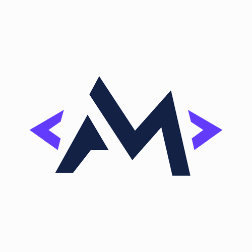

  

<h1 align="center">Olá, eu sou a Andreza Marques! 👋</h1>

Olá, sou estudante de ADS 👋 💻 Desenvolvendo aplicações, aprendendo novas tecnologias e construindo soluções com apoio de inteligência artificial. 🎓 Análise e Desenvolvimento de Sistemas 🚀 Aprendizado contínuo, um projeto de cada vez. Projeto em destaque, Entrelinhas, uma biblioteca pessoal para organizar livros, cursos e trilhas de aprendizagem em um só lugar. Plataformas: Desktop e Web. do Entrelinhas]

Estuda Mais, uma aplicação para organizar matérias, cursos, atividades e metas, ajudando a acompanhar a evolução acadêmica. do Estuda Mais] Aprender, construir e evoluir, um projeto de cada vez.
